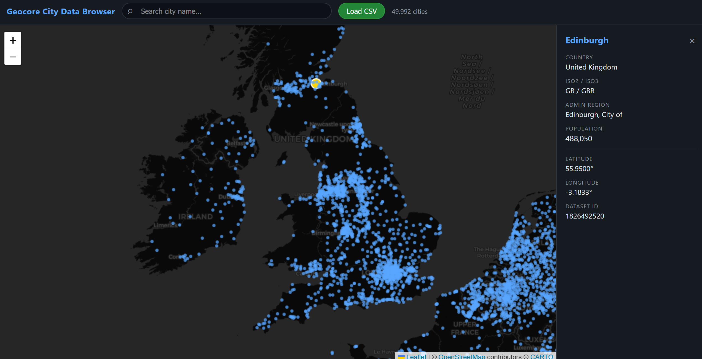
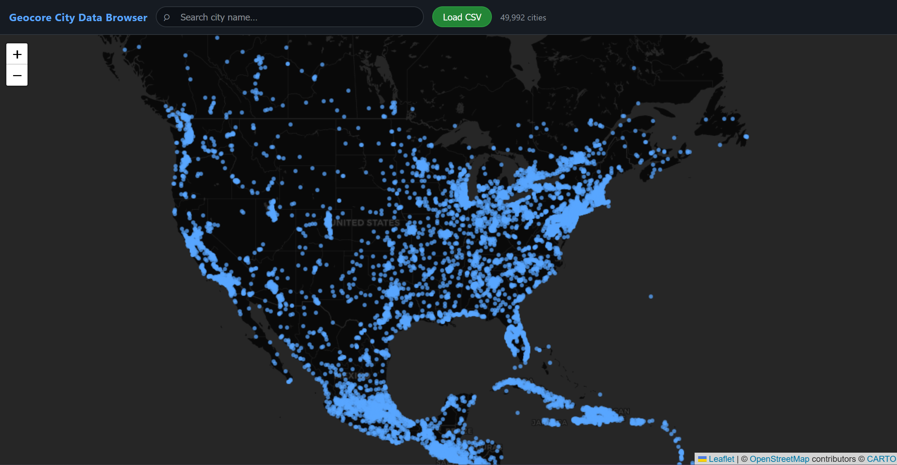

# 🗺️ Geocore City Data Visualizer

**An interactive world map that plots a 47,000-city dataset for Geocore — search, click, and inspect every city's data in one page.**

## About

The **Geocore City Data Visualizer** is a single-page tool for exploring the world-cities dataset that powers our geography game [Geocore](https://geocore.fun). It plots every city as a point on a dark interactive map, lets you search by name, and opens a detail panel showing each city's country, region, capital status, population, and coordinates. Drop in any `worldcities.csv` and it renders in seconds — no build step, no server, just open the file.

## Screenshots

|  |  |
| ------------------------------------------------------------------------------- | ---------------------------------------------------------------------------------- |

## Features

- **~47,000 cities plotted** — the full `worldcities.csv` dataset rendered as points on an interactive world map.
- **Instant search** — type a city name to jump straight to it, with start-of-name matches ranked first.
- **City detail panel** — click any point to see country, ISO2/ISO3 codes, admin region, capital status, population, coordinates, and dataset ID.
- **Drag-and-drop your own data** — auto-loads `worldcities.csv`, or click **Load CSV** to point it at any compatible file.
- **Fast canvas rendering** — points are drawn in batches on a Leaflet canvas layer so even 47K markers stay smooth.

## How to Use

1. Open `index.html` in any modern browser (it auto-loads `worldcities.csv` from the same folder).
2. Use the search bar to find a city, or click any point on the map.
3. Read the detail panel on the right; click **×** to close it.
4. To view a different dataset, click **Load CSV** and pick your own file.

The CSV needs these columns: `city, city_ascii, lat, lng, country, iso2, iso3, admin_name, capital, population, id`.

## Built With

## Links

- 🎮 Play the game: [Geocore.fun](https://geocore.fun)
- 🏢 GitHub Organization: [Geocore-fun](https://github.com/Geocore-fun)
- 👤 Developer: [Anahat Mudgal](https://anahatmudgal.com) · [@AnahatM](https://github.com/AnahatM)

## Author

**Anahat Mudgal**

- Website: [anahatmudgal.com](https://anahatmudgal.com)
- GitHub: [@AnahatM](https://github.com/AnahatM)
